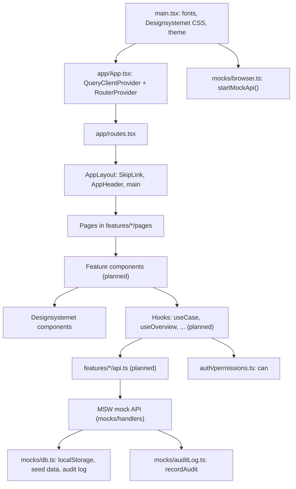
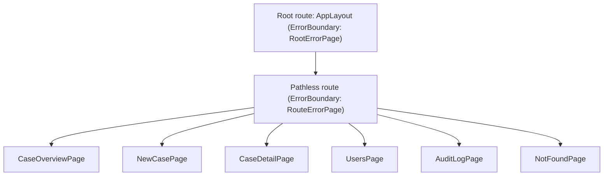

# Architecture *(update as built)*

## Layers
Built so far: app shell, routes, the mock API with users, cases and the audit log, the current user, `can()`,
creating a case (F-001), the case detail page with assigning, closing and reopening, and editing field, health personnel,
companies and reactions (F-001, F-002, F-004), the case overview (F-003), user admin (F-004) and the audit log screens
(F-005). Follow-up, notifications, documents and export are *(planned)*.

## Routes
| Route | Page | Feature | Built |
|---|---|---|---|
| `/` | Case overview (`CaseOverviewPage`), filters in the address (`?field=&status=&reaction=`); leaders' notice about deactivated case workers on top, their "Lent out" list at the bottom | F-003, F-004 | Yes |
| `/cases/new` | New case, Leader only (`NewCasePage`) | F-001 | Yes |
| `/cases/:id` | Case detail; assign, read access and per-case audit log for Leader; restricted view for Admin (`CaseDetailPage`) | F-002, F-004, F-005 | Yes |
| `/admin/users` | User admin: list, add, deactivate, reactivate, change fields and department (`UsersPage`) | F-004 | Yes |
| `/admin/audit` | Global audit log for Admin, filters in the address (`?case=&action=&userId=&result=&from=&to=`) (`AuditLogPage`) | F-005 | Yes |
| any other | Page not found (`NotFoundPage`) | – | Yes |

The main navigation links to Cases, and for those `can()` allows, to Users and Audit log (F-004).
A mock-only **Test environment** bar above the header holds the user switcher ("Acting as") and **Reset mock data**.

## Mock API
| Endpoint | What it does |
|---|---|
| `GET /api/current-user` | The user the app acts as |
| `GET /api/cases` | The cases the user may see, newest first (F-003); restricted rows without reactions for Admin |
| `POST /api/cases` | Create a case, body `{ field }` (F-001); 403 and a Denied audit entry if not allowed |
| `GET /api/cases/:id` | Open a case: full, or restricted for Admin (F-002, F-004); 403 + Denied entry without access; 404 if missing; logs "case opened" |
| `GET /api/cases/:id/eligible-case-workers` | Case workers the case can be assigned to, from every department (F-004, leaders) |
| `PUT /api/cases/:id/assignee` | Assign or reassign, body `{ caseWorkerId }` (F-004); returns the updated case |
| `PATCH /api/cases/:id/field` | Change the field, body `{ field }` (F-002, assigned case worker) |
| `POST /api/cases/:id/health-personnel` | Add a health personnel (F-002); 409 if the number is already on the case |
| `DELETE /api/cases/:id/health-personnel/:personId` | Remove a health personnel (F-002) |
| `POST /api/cases/:id/companies` | Add a company (F-002); 409 if the organization number is already on the case |
| `DELETE /api/cases/:id/companies/:companyId` | Remove a company (F-002) |
| `PUT /api/cases/:id/health-personnel/:personId/reaction` | Give a health personnel a reaction, body `{ reaction }` (F-002) |
| `PUT /api/cases/:id/companies/:companyId/reaction` | Give a company a reaction, body `{ reaction }` (F-002) |
| `POST /api/cases/:id/close` | Close the case (F-002, assigned case worker); 409 if a party has no reaction or there are none |
| `POST /api/cases/:id/reopen` | Reopen a closed case (F-004, leader); it becomes In progress |
| `GET /api/cases/:id/read-access` | Who has read access and who could get it (F-004, leader) |
| `POST /api/cases/:id/read-access` | Give read access, body `{ caseWorkerId }` (F-004) |
| `DELETE /api/cases/:id/read-access/:caseWorkerId` | Remove read access (F-004) |
| `GET /api/users` | Every user (F-004, Admin) |
| `POST /api/users` | Add a user (F-004, Admin); 409 if the email is already used |
| `POST /api/users/:id/deactivate` | Deactivate a user (F-004, Admin; not themselves) |
| `POST /api/users/:id/reactivate` | Reactivate a deactivated user (F-004, Admin) |
| `PUT /api/users/:id/fields` | Change a user's fields, body `{ primaryField, fields }` (F-004, Admin) |
| `GET /api/users/:id/blocking-cases` | Open cases that keep a user from moving department (F-004, Admin) |
| `PUT /api/users/:id/department` | Move a user, body `{ departmentId }` (F-004, Admin); 409 while open cases block it |
| `GET /api/notifications` | The current user's notifications (F-004: cases with a deactivated case worker, for leaders) |
| `GET /api/cases/:id/audit-log` | The audit log for one case, newest first, with the names and case numbers it refers to (F-005, leaders of the case's department) |
| `GET /api/audit-log` | The whole audit log, newest first, filtered by `case` (id or number), `action`, `userId`, `result`, `from`, `to` (F-005, Admin) |
| `GET /api/lent-out-cases` | The leader's case workers on cases (not closed) in other departments (F-004, leaders) |
| `GET /api/mock/users` | All users (mock only; for the user switcher) |
| `PUT /api/mock/current-user` | Act as another user, body `{ userId }` (mock only) |
| `POST /api/mock/reset` | Replace all data with the seed data (mock only) |

## Current user
`useCurrentUser()` (from `@/features/auth`) returns the user the app acts as. It always returns a user:
while it loads, the `<Suspense>` around every page in `AppLayout` shows a spinner. The current user is
stored by the mock API (in `localStorage`), so the choice survives a reload, and the mock API can use it
for permission checks.

Switching user or resetting the mock data drops all cached data except the current user, then updates the
current user; each part of the page still shown for the new user loads its own data. (Refetching everything at once
would load the previous user's data as the new user, for example a leader's assign list as a case worker.)

A change to a case (assigning, later editing) updates the page from the mock API's response instead of refetching
the case, since every fetch of a case is logged as "case opened".

Permission-checked endpoints for cases and users come with their features. All calls go through
`apiRequest` (`shared/api/apiRequest.ts`), which checks responses with a Zod schema.

## App shell

- **Errors:** a failing page shows "Something went wrong" inside the shell, so the header stays.
  If the shell itself fails, `RootErrorPage` renders it again around the message. Error details are never shown.
- **Page titles and focus:** every page uses `Page` (`shared/components/Page.tsx`), which sets the document title
  and renders the h1. After client-side navigation, `AppLayout` moves focus to the new h1.
  See [decision 0009](decisions/0009-page-titles-and-focus.md).
- **Skip link:** "Skip to main content" is the first focusable element and jumps to `<main id="main-content">`.

## Folders
See [folder-structure.md](conventions/folder-structure.md).
