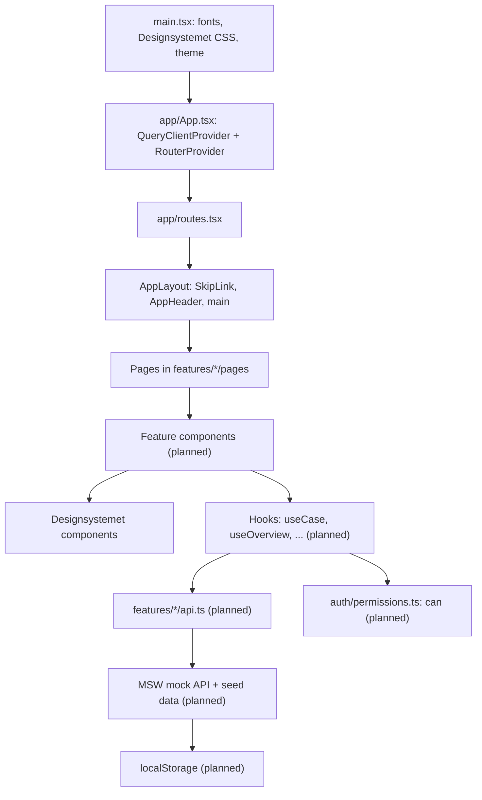
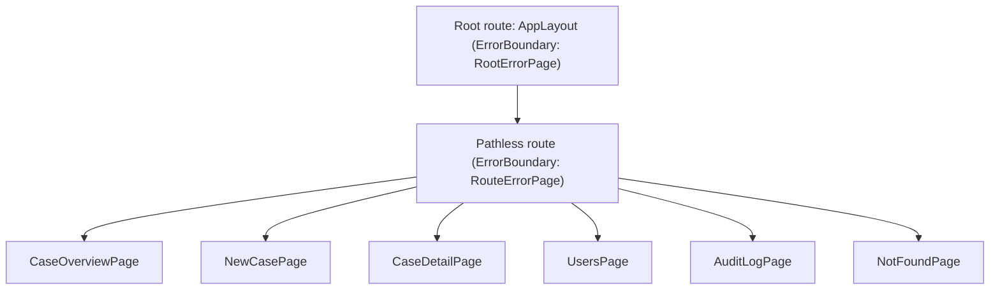

# Architecture *(update as built)*

## Layers
Built so far: app shell, routes and empty pages. Everything else is *(planned)*.

## Routes
| Route | Page | Feature | Built |
|---|---|---|---|
| `/` | Case overview (`CaseOverviewPage`) | F-003 | Empty page |
| `/cases/new` | New case, Leader only (`NewCasePage`) | F-001 | Empty page |
| `/cases/:id` | Case detail; assign, read access and per-case audit log for Leader; restricted view for Admin (`CaseDetailPage`) | F-002, F-004, F-005 | Empty page |
| `/admin/users` | User admin: add, deactivate, change fields and department (`UsersPage`) | F-004 | Empty page |
| `/admin/audit` | Global audit log (`AuditLogPage`) | F-005 | Empty page |
| any other | Page not found (`NotFoundPage`) | – | Yes |

The main navigation links to Cases, Users and Audit log. Hiding links by role comes with `can()` (F-004).
`/cases/new` gets its "New case" button on the overview with F-001.
The header will also hold the mock-only user switcher and **Reset mock data** *(planned, T0.6 and T0.5)*.

## App shell

- **Errors:** a failing page shows "Something went wrong" inside the shell, so the header stays.
  If the shell itself fails, `RootErrorPage` renders it again around the message. Error details are never shown.
- **Page titles and focus:** every page uses `Page` (`shared/components/Page.tsx`), which sets the document title
  and renders the h1. After client-side navigation, `AppLayout` moves focus to the new h1.
  See [decision 0009](decisions/0009-page-titles-and-focus.md).
- **Skip link:** "Skip to main content" is the first focusable element and jumps to `<main id="main-content">`.

## Folders
See [folder-structure.md](conventions/folder-structure.md).
