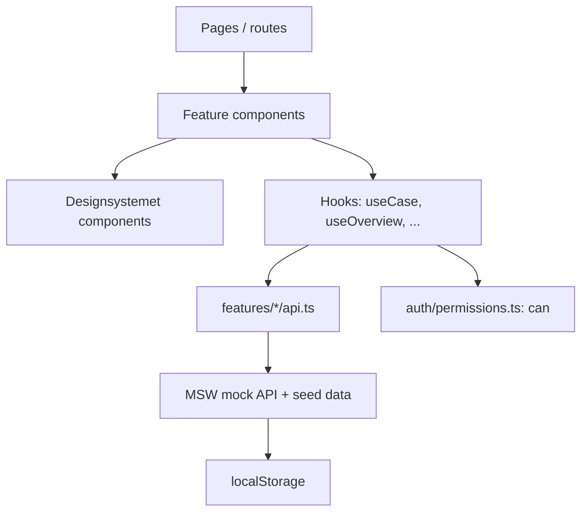

# Architecture *(planned, update as built)*

## Layers

## Pages
| Route | Page | Feature |
|---|---|---|
| `/` | Case overview | F-003 |
| `/cases/new` | New case (Leader) | F-001 |
| `/cases/:id` | Case detail; assign, read access and per-case audit log for Leader; restricted view for Admin | F-002, F-004, F-005 |
| `/admin/users` | User admin: add, deactivate, change fields and department | F-004 |
| `/admin/audit` | Global audit log | F-005 |

The app shell header also holds the mock-only user switcher and **Reset mock data**.

## Folders
See [folder-structure.md](conventions/folder-structure.md).
