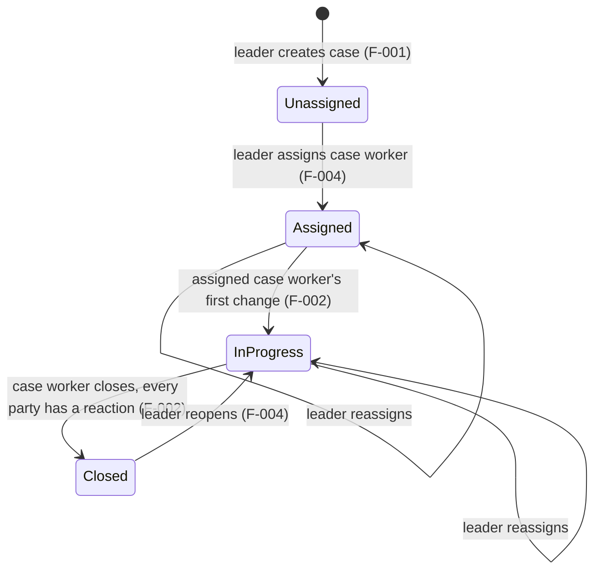
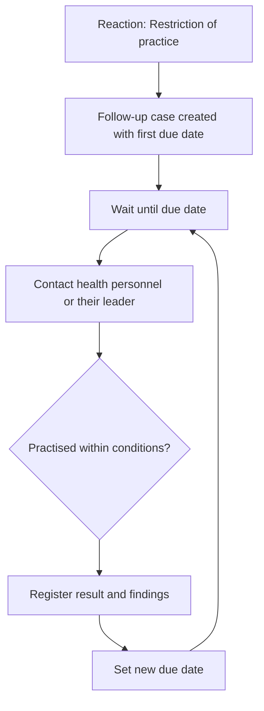

# Case lifecycle

## Supervision case

- A `Closed` case cannot be changed by anyone until a leader reopens it.
- Rules and who can do what: [SPEC.md, Case status](../SPEC.md#case-status).
- All transitions are built: created as Unassigned (T2.1), assign and reassign (T2.3), InProgress on the first change
  (T2.4), close and reopen (T2.7). Every status change is logged as "status changed" (F-005).

## Follow-up (F-010) *(planned, Draft)*

