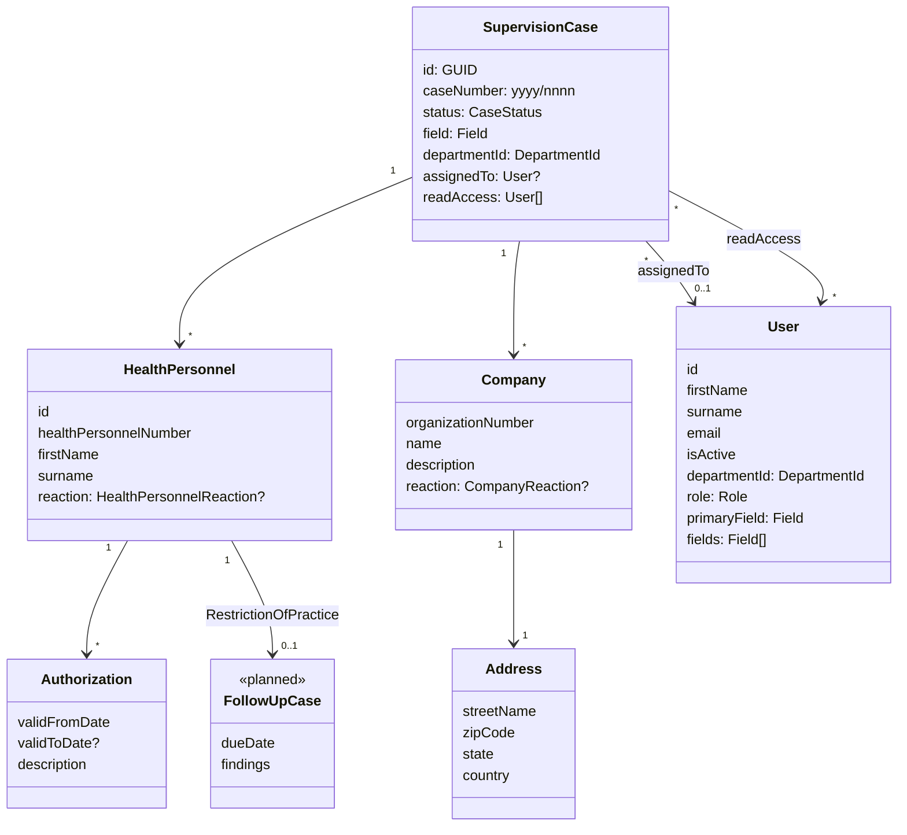

# Domain model *(planned, update as built)*

`FollowUpCase` belongs to F-010, which is still Draft *(planned)*.

- `CaseStatus`: Unassigned, Assigned, InProgress, Closed
- `HealthPersonnelReaction`: NoReaction, Prohibition, RestrictionOfPractice
- `CompanyReaction`: NoReaction, SelfAssessment
- `Field`: Health, Social, ChildServices
- `Role`: CaseWorker, Leader, Admin (one per user)
- `DepartmentId`: 1 Department of Supervision, 2 Department of Child Welfare, 3 Department of Business Management
