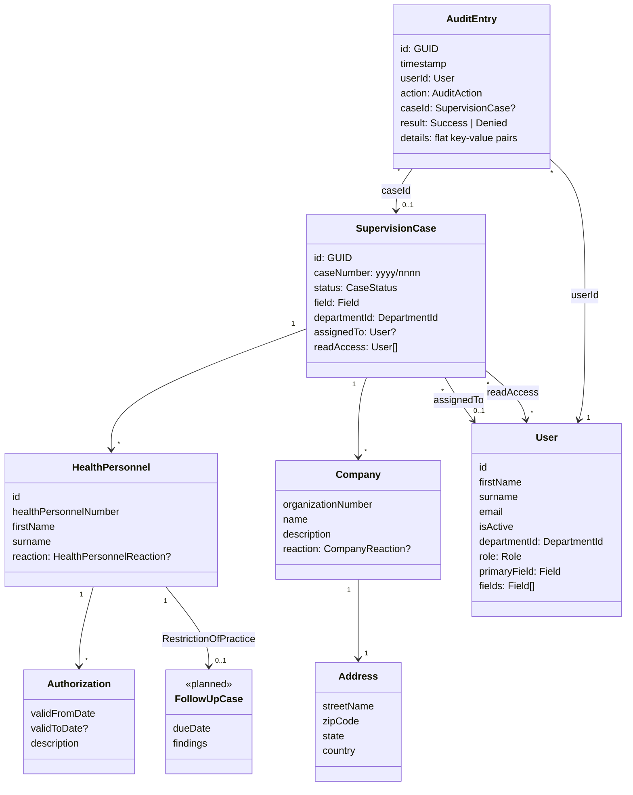

# Domain model

Built as Zod schemas, with the TypeScript types inferred from them (decision 0005):
`features/auth/types.ts` (User), `features/cases/types.ts` (case, parties, reactions) and
`features/audit-log/types.ts` (audit entries). Only `FollowUpCase` is *(planned)*.

`FollowUpCase` belongs to F-010, which is still Draft *(planned)*.

- `CaseStatus`: Unassigned, Assigned, InProgress, Closed
- `HealthPersonnelReaction`: NoReaction, Prohibition, RestrictionOfPractice
- `CompanyReaction`: NoReaction, SelfAssessment
- `Field`: Health, Social, ChildServices
- `Role`: CaseWorker, Leader, Admin (one per user)
- `DepartmentId`: 1 Department of Supervision, 2 Department of Child Welfare, 3 Department of Business Management
- `AuditAction`: CaseCreated, CaseUpdated, CaseAssigned, StatusChanged, ReactionGiven, ReadAccessGranted,
  ReadAccessRemoved, CaseOpened, UserAdded, UserUpdated

## Rules checked by the schemas
| Rule (SPEC.md) | Where |
|---|---|
| Case number `yyyy/nnnn` | `caseNumberSchema` |
| Health personnel number: 7 to 9 digits, digits only | `healthPersonnelNumberSchema` |
| Organization number: 9 digits | `organizationNumberSchema` |
| At least one authorization per health personnel | `healthPersonnelSchema` |
| `validToDate` optional (`null`), on or after `validFromDate` | `authorizationSchema` |
| Reactions allowed per party | `healthPersonnelReactionSchema`, `companyReactionSchema` |
| Address: street name, zip code, state, country | `addressSchema` |
| No duplicate health personnel, companies or read access in a case | `supervisionCaseSchema` |
| `fields` includes `primaryField` | `userSchema` |
| Audit `details` are flat (no nested data) | `auditDetailsSchema` |

Rules about *who* may do *what* (permissions, status changes) are not in the schemas; they come with `can()` (T1.2).
