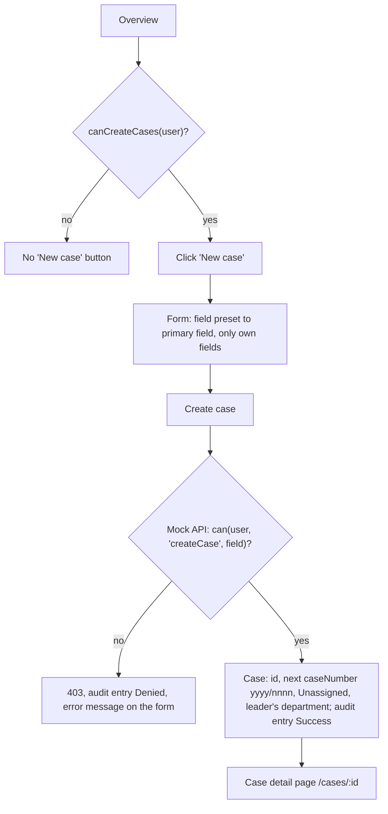
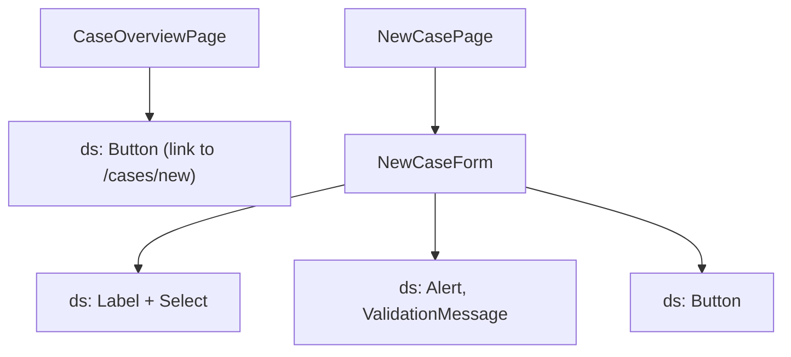

# F-001 Create supervision case

**Status:** Done
**Spec:** [SPEC.md](../../SPEC.md#f-001-create-supervision-case-approved-2026-10-17)

## What it does
A leader creates a new supervision case in one of their fields. Id, case number, status and department are set
automatically. Afterwards the leader lands on the case detail page, where they can assign it (F-004).

## Who can use it
| Role | Can |
|---|---|
| CaseWorker | – (no "New case" button; the page says only leaders can create cases; the mock API rejects it) |
| Leader | Create cases in own department and own fields |
| Admin | – (as CaseWorker) |

## User flow

## Screens and components

## Data
- `SupervisionCase`, `Field`; `createCase()` (`features/cases/api.ts`), `useCreateCase()`, `canCreateCases(user)`.
- `POST /api/cases` with `{ field }` (mock): 201 with the new case; 403 if not allowed; 400 for an invalid body.
- Case number: `nextCaseNumber` and `lastSequenceInYear` (`features/cases/caseNumber.ts`): one sequence for all
  departments, starting at 0001 every year.
- Audit: "case created" with `Success` (details: case number, field) or `Denied` (details: field).

## Built so far
| Part | Task | Status |
|---|---|---|
| Button, form, mock endpoint, case number, audit | T2.1 | Done |
| Case detail page the leader lands on | T2.2 | Done |
| Assigning from the case detail page | T2.3 | Done (F-004) |
