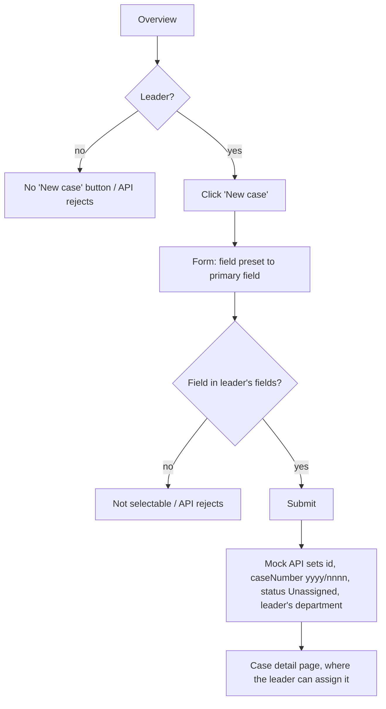
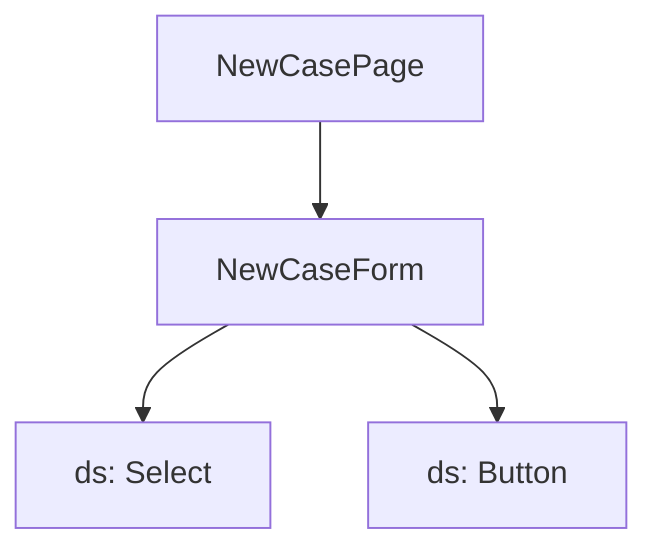

# F-001 Create supervision case

**Status:** Approved
**Spec:** [SPEC.md](../../SPEC.md#f-001-create-supervision-case-approved-2026-10-17)

## What it does
A leader creates a new supervision case in one of their fields. Id, case number, status and department are set automatically.

## Who can use it
| Role | Can |
|---|---|
| CaseWorker | – |
| Leader | Create cases in own department and own fields |
| Admin | – |

## User flow

## Screens and components *(planned)*

## Data
`SupervisionCase`, `Field`, `useCreateCase()`, `POST /cases` (mock).
