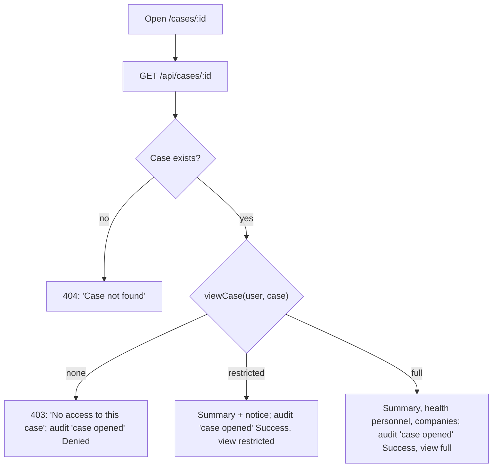
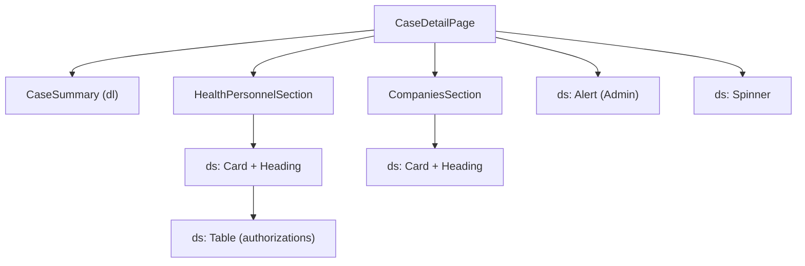
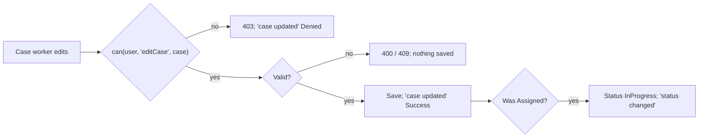

# F-002 Expand supervision case

**Status:** In progress
**Spec:** [SPEC.md](../../SPEC.md#f-002-expand-supervision-case-approved-2026-10-17)

## What it does
The case detail page shows a case: summary, health personnel with authorizations and reactions, and companies
with address and reactions. The assigned case worker will edit it and close it (later tasks). Admin sees the case
without its sensitive data.

## Who can use it
| Role | Can |
|---|---|
| CaseWorker | Read cases assigned to them or given read access to; edit their assigned cases (not when closed); close them *(planned)* |
| Leader | Read all cases in own department |
| Admin | Read any case in the restricted view: summary only, health personnel and companies hidden |

## User flow

"Case opened" is logged once each time the page is opened: the page does not refetch on window focus, and a
refused case is not retried.

## Screens and components

## Editing (assigned case worker)
- **Change field:** only to one of the case worker's own fields; shown only when they have more than one.
- **Add health personnel:** health personnel number (7 to 9 digits), first name, surname, and one or more
  authorizations (description, valid from, optional valid to on or after valid from). The same number cannot be
  added twice (409). The form (`forms/healthPersonnelForm.ts`) uses the same rules as the mock API's
  `newHealthPersonnelSchema`, with messages that say what to do.
- **Remove health personnel:** after a confirmation dialog.
- **Add company:** organization number (9 digits), name, optional description, and address (street name, zip code,
  state, country). The same organization number cannot be added twice (409). Rules in `forms/companyForm.ts`,
  matching the mock API's `newCompanySchema`.
- **Remove company:** after a confirmation dialog (`ConfirmRemoveButton`, shared with health personnel).
- **Reactions:** each health personnel and company has a "Reaction for …" selector offering only its allowed
  reactions (health personnel: No reaction, Prohibition, Restriction of practice; company: No reaction,
  Self-assessment). A reaction can be changed later; giving the same reaction again is refused (400). Logged as
  "reaction given" with the party's id only: the reaction itself is sensitive case data. Others see the reaction
  as text.
- **First change:** an Assigned case becomes InProgress ("status changed" is logged).
- Every change is logged as "case updated" with `details.change` (`FieldChanged`, `HealthPersonnelAdded`,
  `HealthPersonnelRemoved`, `CompanyAdded`, `CompanyRemoved`) and the party's id, never names or numbers.
  Denied attempts are logged too.
- The page updates from each response, so editing never adds a "case opened" entry.
- Editing a health personnel already on the case is not part of F-002 (remove and add again).

## Data
- `useCase(id)` / `caseQuery(id)` (`features/cases`), `caseResponseSchema`: `{ access: 'full' | 'restricted',
  supervisionCase, assignedCaseWorker }`. The assigned case worker's name and active status come with the case;
  a deactivated case worker is shown as "(deactivated)".
- `GET /api/cases/:id` (mock), using `viewCase` (F-004) and `recordAudit` (F-005).
- `PATCH /api/cases/:id/field`, `POST /api/cases/:id/health-personnel`, `DELETE /api/cases/:id/health-personnel/:personId`
  `POST /api/cases/:id/companies`, `DELETE /api/cases/:id/companies/:companyId`,
  `PUT /api/cases/:id/health-personnel/:personId/reaction`, `PUT /api/cases/:id/companies/:companyId/reaction`
  (mock, `handlers/caseEditing.ts`); each returns the updated case.
- Dates are shown with `formatDate` ("1 Jan 2020").

## Built so far
| Part | Task | Status |
|---|---|---|
| Case detail page, read-only, restricted view for Admin, "case opened" logged | T2.2 | Done |
| Edit field; add and remove health personnel; InProgress on first change | T2.4 | Done |
| Add and remove companies | T2.5 | Done |
| Reactions | T2.6 | Done |
| Close case | T2.7 | *(planned)* |
