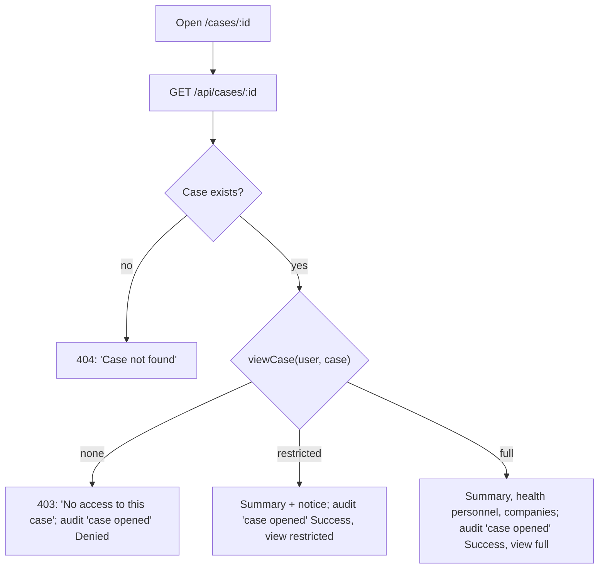
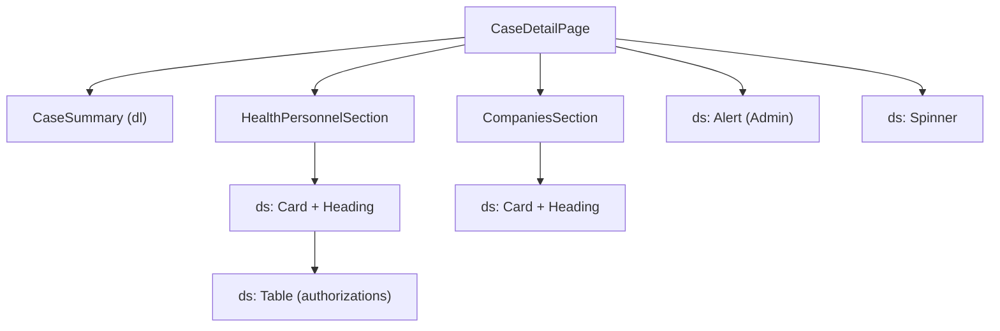

# F-002 Expand supervision case

**Status:** In progress
**Spec:** [SPEC.md](../../SPEC.md#f-002-expand-supervision-case-approved-2026-10-17)

## What it does
The case detail page shows a case: summary, health personnel with authorizations and reactions, and companies
with address and reactions. The assigned case worker will edit it and close it (later tasks). Admin sees the case
without its sensitive data.

## Who can use it
| Role | Can |
|---|---|
| CaseWorker | Read cases assigned to them or given read access to; edit and close their assigned cases *(planned)* |
| Leader | Read all cases in own department |
| Admin | Read any case in the restricted view: summary only, health personnel and companies hidden |

## User flow

"Case opened" is logged once each time the page is opened: the page does not refetch on window focus, and a
refused case is not retried.

## Screens and components

## Data
- `useCase(id)` / `caseQuery(id)` (`features/cases`), `caseResponseSchema`: `{ access: 'full' | 'restricted',
  supervisionCase, assignedCaseWorker }`. The assigned case worker's name and active status come with the case;
  a deactivated case worker is shown as "(deactivated)".
- `GET /api/cases/:id` (mock), using `viewCase` (F-004) and `recordAudit` (F-005).
- Dates are shown with `formatDate` ("1 Jan 2020").

## Built so far
| Part | Task | Status |
|---|---|---|
| Case detail page, read-only, restricted view for Admin, "case opened" logged | T2.2 | Done |
| Edit field; add and remove health personnel; InProgress on first change | T2.4 | *(planned)* |
| Add and remove companies | T2.5 | *(planned)* |
| Reactions | T2.6 | *(planned)* |
| Close case | T2.7 | *(planned)* |
