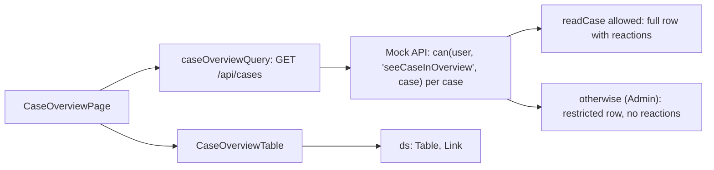

# F-003 Case overview

**Status:** In progress
**Spec:** [SPEC.md](../../SPEC.md#f-003-case-overview-approved-2026-10-17)

## What it does
The Cases page (`/`) lists the cases the user may see, newest first, with case number, field, status, assigned
case worker and reactions. The case number opens the case. Filters come in T3.2.

## Who can use it
| Role | Sees |
|---|---|
| CaseWorker | Cases assigned to them and cases they have read access to |
| Leader | Every case in their department |
| Admin | Every case, without reactions (restricted rows, F-004) |

## How it works

- Rows (`overviewRowSchema`, `features/overview/types.ts`): id, case number, field, status, department, assigned
  case worker (name, deactivated), and for full rows the reactions given in the case (`reactionsInCase`, each once).
  Restricted rows are strict: a row that still has reactions is rejected.
- The reactions column is left out when no row has reactions (Admin).
- Sorted newest first by case number (year, then sequence, also past 9999).
- Listing cases is not logged as "case opened"; only opening a case is.
- The query is under `['cases']`, so creating a case refreshes the overview.

## Built so far
| Part | Task | Status |
|---|---|---|
| Overview table per role | T3.1 | Done |
| Filters: field, status, reaction; combine and clear; empty message | T3.2 | *(planned)* |

## Data
`GET /api/cases` (mock, `handlers/cases.ts`), `caseOverviewQuery`, `OverviewRow`, `reactionsInCase`, `REACTION_LABELS`.
