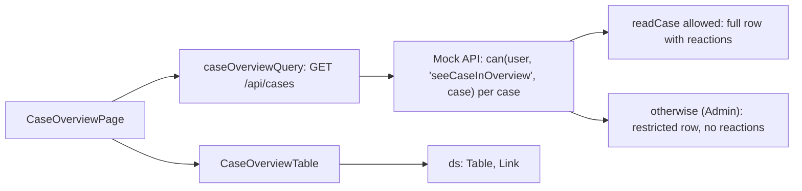

# F-003 Case overview

**Status:** Done
**Spec:** [SPEC.md](../../SPEC.md#f-003-case-overview-approved-2026-10-17)

## What it does
The Cases page (`/`) lists the cases the user may see, newest first, with case number, field, status, assigned
case worker and reactions. The case number opens the case. Filters narrow the list by field, status and reaction.

## Who can use it
| Role | Sees |
|---|---|
| CaseWorker | Cases assigned to them and cases they have read access to |
| Leader | Every case in their department |
| Admin | Every case, with its department and without reactions (restricted rows, F-004) |

## How it works

- Rows (`overviewRowSchema`, `features/overview/types.ts`): id, case number, field, status, department, assigned
  case worker (name, deactivated), and for full rows the reactions given in the case (`reactionsInCase`, each once).
  Restricted rows are strict: a row that still has reactions is rejected.
- The reactions column is left out when no row has reactions (Admin). Instead, Admin gets a **Department** column
  after the case number, as they see cases from every department.
- Sorted newest first by case number (year, then sequence, also past 9999).
- Listing cases is not logged as "case opened"; only opening a case is.
- The query is under `['cases']`, so creating a case refreshes the overview.

## Filters
- **Field**, **Status** and **Reaction**, one value each or "All"; they combine (a case must match all).
- A case matches a reaction if any health personnel or company in it has it (`filterRows`, `features/overview/filters.ts`).
- Admin has no reaction filter (restricted rows have no reactions); a reaction in the address is ignored for Admin.
- Kept in the page address (`?field=Health&status=Closed`): they survive a reload and can be bookmarked. Unknown
  values are ignored. Each change replaces the address, so Back leaves the page instead of undoing filters.
- "Showing 2 of 5 cases." is announced when filters are set; "No cases match the filters." when nothing matches;
  **Clear filters** removes them all.
- On narrow screens the table scrolls sideways inside its own region ("Cases table") instead of being cut off.

## Built so far
| Part | Task | Status |
|---|---|---|
| Overview table per role | T3.1 | Done |
| Filters: field, status, reaction; combine and clear; empty message | T3.2 | Done |
| Department column for Admin (Tine, after T3.9) | – | Done |

## Data
`GET /api/cases` (mock, `handlers/cases.ts`), `caseOverviewQuery`, `OverviewRow`, `reactionsInCase`, `REACTION_LABELS`.
