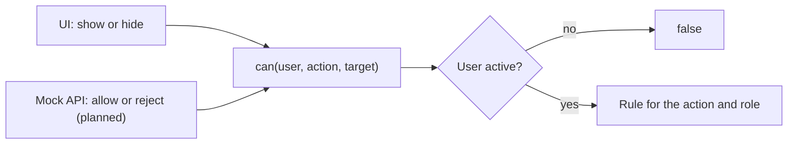

# F-004 Access control

**Status:** In progress
**Spec:** [SPEC.md](../../SPEC.md#f-004-access-control-approved-2026-10-17), permission table in [SPEC.md, Permissions](../../SPEC.md#permissions)

## What it does
Decides what each user may do, based on their role, department and relation to the case. Leaders distribute
work in their department, case workers handle the cases assigned to them, and admins manage users and see all
cases with sensitive data hidden.

## Who can use it
| Role | Can |
|---|---|
| CaseWorker | See, read and edit cases assigned to them (not when closed); close them when in progress; read cases they have been given read access to |
| Leader | Create cases in own fields; see and read all cases in own department; assign and reassign, give and remove read access (not when closed); reopen closed cases; view the audit log per case |
| Admin | See all cases and open them with sensitive data hidden; view the global audit log; add and deactivate users, change their fields and department |

A deactivated user may do nothing.

## How it works
All checks go through `can(user, action, target)` in `src/features/auth/permissions.ts`, imported from
`@/features/auth`. One rule per row of the SPEC.md permission table.

| Action | Target | Row in SPEC.md |
|---|---|---|
| `seeCaseInOverview` | case | See cases in overview |
| `createCase` | `{ field }` | Create case |
| `readCase` | case | Read case (full) |
| `readCaseRestricted` | case | Read case (restricted) |
| `editCase` | case | Edit case |
| `closeCase` | case | Close case |
| `reopenCase` | case | Reopen closed case |
| `assignCase` | case | Assign / reassign case |
| `manageReadAccess` | case | Give / remove read access |
| `viewCaseAuditLog` | case | View audit log per case |
| `viewGlobalAuditLog` | – | View global audit log |
| `manageUsers` | – | Add users, deactivate users, change fields and department |

## Admin's restricted view
`viewCase(user, case)` (`features/cases/restrictedView.ts`) gives the full case, the restricted view, or nothing,
using `can()`. The restricted view is an **allowlist**: Admin gets only `id`, `caseNumber`, `status`, `field`,
`departmentId` and `assignedTo`. Health personnel, companies (and with them authorizations and reactions) and
`readAccess` are left out.

- `toRestrictedCase` copies the allowed fields one by one, never with a spread, so new case fields stay hidden.
- `restrictedSupervisionCaseSchema` is strict: data that still contains a hidden field is rejected.
- A test fails if a case field is in neither `ADMIN_VISIBLE_FIELDS` nor `ADMIN_HIDDEN_FIELDS`, so adding a field forces a decision.
- The mock API sends Admin only this view (`GET /api/cases/:id`, since T2.2).

Checked separately, in later tasks: who a case can be assigned to or given read access (active case worker in the
leader's department with the case's field), and whether every party has a reaction before closing.

## Built so far
| Part | Task | Status |
|---|---|---|
| `can()` for the whole permission table | T1.2 | Done |
| Restricted case view for Admin | T1.3 | Done |
| Assign and reassign | T2.3 | *(planned)* |
| Close and reopen | T2.7 | *(planned)* |
| Read access | T3.3 | *(planned)* |
| User admin | T3.4, T3.5, T3.6 | *(planned)* |

## Data
`User`, `Role` (`features/auth/types.ts`), `SupervisionCase` (`features/cases/types.ts`), `can()`.
