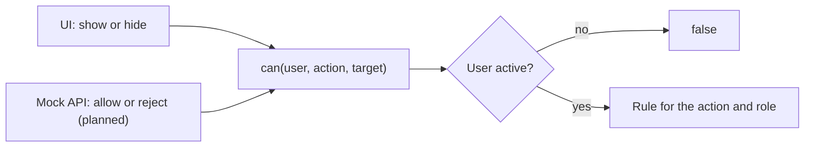

# F-004 Access control

**Status:** In progress
**Spec:** [SPEC.md](../../SPEC.md#f-004-access-control-approved-2026-10-17), permission table in [SPEC.md, Permissions](../../SPEC.md#permissions)

## What it does
Decides what each user may do, based on their role, department and relation to the case. Leaders distribute
work in their department, case workers handle the cases assigned to them, and admins manage users and see all
cases with sensitive data hidden.

## Who can use it
| Role | Can |
|---|---|
| CaseWorker | See, read and edit cases assigned to them (not when closed); close them when in progress; read cases they have been given read access to |
| Leader | Create cases in own fields; see and read all cases in own department; assign and reassign, give and remove read access (not when closed); reopen closed cases; view the audit log per case |
| Admin | See all cases and open them with sensitive data hidden; view the global audit log; add, deactivate and reactivate users, change their fields and department |

A deactivated user may do nothing.

## How it works
All checks go through `can(user, action, target)` in `src/features/auth/permissions.ts`, imported from
`@/features/auth`. One rule per row of the SPEC.md permission table.

| Action | Target | Row in SPEC.md |
|---|---|---|
| `seeCaseInOverview` | case | See cases in overview |
| `createCase` | `{ field }` | Create case |
| `readCase` | case | Read case (full) |
| `readCaseRestricted` | case | Read case (restricted) |
| `editCase` | case | Edit case |
| `closeCase` | case | Close case |
| `reopenCase` | case | Reopen closed case |
| `assignCase` | case | Assign / reassign case |
| `manageReadAccess` | case | Give / remove read access |
| `viewCaseAuditLog` | case | View audit log per case |
| `viewGlobalAuditLog` | – | View global audit log |
| `manageUsers` | – | Add users, deactivate and reactivate users, change fields and department |

## Admin's restricted view
`viewCase(user, case)` (`features/cases/restrictedView.ts`) gives the full case, the restricted view, or nothing,
using `can()`. The restricted view is an **allowlist**: Admin gets only `id`, `caseNumber`, `status`, `field`,
`departmentId` and `assignedTo`. Health personnel, companies (and with them authorizations and reactions) and
`readAccess` are left out.

- `toRestrictedCase` copies the allowed fields one by one, never with a spread, so new case fields stay hidden.
- `restrictedSupervisionCaseSchema` is strict: data that still contains a hidden field is rejected.
- A test fails if a case field is in neither `ADMIN_VISIBLE_FIELDS` nor `ADMIN_HIDDEN_FIELDS`, so adding a field forces a decision.
- The mock API sends Admin only this view (`GET /api/cases/:id`, since T2.2), and in the overview only restricted
  rows without reactions (`GET /api/cases`, since T3.1).

## Assigning a case
- `isEligibleCaseWorker(candidate, case)` (`features/cases/assignment.ts`): an active case worker in the case's
  department with the case's field. Checked by the mock API and used for the list on the case page.
- `GET /api/cases/:id/eligible-case-workers` lists them; `PUT /api/cases/:id/assignee` with `{ caseWorkerId }`
  assigns. Unassigned becomes Assigned; a reassigned case keeps its status. 403 + Denied entry if
  `can(user, 'assignCase', case)` says no (also for Closed cases); 400 for a case worker who is not eligible or
  already has the case.
- Audit: "case assigned" with `previousCaseWorkerId` (or null) and `newCaseWorkerId`; "status changed" when
  Unassigned becomes Assigned. A deactivated case worker can be replaced like any other.
- The case page shows "Assign case" / "Reassign case" only to users `can()` lets assign, and does not offer the
  current case worker.

## Reopening a case
- A leader sees **Reopen case** on a closed case in their department (`can(user, 'reopenCase', case)`); the case
  becomes In progress so the assigned case worker can change it again.
- `POST /api/cases/:id/reopen`: 403 + Denied entry otherwise; logged as "status changed" (Closed → InProgress).

## Read access
- A leader sees a **Read access** section on cases in their department that are not closed
  (`can(user, 'manageReadAccess', case)`): who has read access (each with Remove) and "Give read access to".
- Who can receive it: `canReceiveReadAccess(candidate, case)` (`features/cases/readAccess.ts`): an active case
  worker in the case's department who is not the assigned case worker and does not already have it. No field needed.
- Case workers with read access see the case in their overview and open it read-only.
- `GET /api/cases/:id/read-access` (granted + candidates, not logged), `POST /api/cases/:id/read-access` with
  `{ caseWorkerId }`, `DELETE /api/cases/:id/read-access/:caseWorkerId`. 403 + Denied entry if not allowed (also on
  closed cases), 400 for someone who cannot receive or does not have it.
- Audit: "read access granted" / "read access removed" with `caseWorkerId`.

## User admin
- **Users** page (`/admin/users`, `features/admin`), Admin only (`can(user, 'manageUsers')`); others see
  "Only admins can manage users." and the mock API refuses them.
- A table of every user: name, email, role, department, fields (primary marked) and status, sorted by department
  and name.
- **Add user** with every User field: first name, surname, email, role, department, primary field and other fields.
  The other-field checkboxes leave out the primary field, so `fields` always includes it (`forms/userForm.ts`, same
  rules as the mock API's `newUserSchema`). New users are active; id, `createdAt` and `updatedAt` are set by the mock API.
- Email must be unique, compared without regard to case (409: "A user with this email already exists.").
- `GET /api/users` (not logged), `POST /api/users` (logged as "user added" with `addedUserId`; Denied when refused).
- A new user also appears in the mock user switcher.

## Deactivating a user
- Admin sees **Deactivate** for every active user except themselves; a dialog explains what happens first.
- `POST /api/users/:id/deactivate`: `isActive` false, `updatedAt` set; logged as "user updated"
  (`updatedUserId`, `isActive: false`). 403 + Denied entry for non-admins; 400 for an admin deactivating
  themselves or a user who is already deactivated.
- A deactivated user may do nothing (`can()` returns false), cannot be assigned or given read access, and stays as
  case worker on their cases, shown as "(deactivated)" everywhere.
- **Leader notification** (placement chosen by Tine): a warning list at the top of the leader's Cases page,
  "*n* cases have a deactivated case worker", each linking to the case. It lists cases the leader can reassign
  (own department, not closed) and disappears when they reassign the case. Comes from `GET /api/notifications`
  (`features/notifications`), which F-012 can extend.

## Reactivating a user
- Admin sees **Reactivate** for every deactivated user. Nothing is lost by it, so there is no confirmation; the page
  says "*name* was reactivated."
- `POST /api/users/:id/reactivate`: `isActive` true, `updatedAt` set; logged as "user updated"
  (`updatedUserId`, `isActive: true`). 403 + Denied entry for non-admins; 400 for a user who is already active.
- They can use the app again and be assigned cases or given read access. Their department and fields are as before.
  Cases still assigned to them are theirs again, so leaders' "deactivated case worker" notices about them disappear.

## Changing a user's fields and department
- **Edit** on each row of the Users page opens an "Edit *name*" panel above the table (focus moves to it).
- **Fields:** primary field plus other fields (`PUT /api/users/:id/fields`). Changing the primary field keeps the old
  one as an other field unless Admin unticks it. Their cases do not change. Logged as "user updated"
  (`change: Fields`, the new fields).
- **Department:** a permanent move (`PUT /api/users/:id/department`). While the user is the case worker of open
  cases in their current department, the panel lists them (`GET /api/users/:id/blocking-cases`, with links) and
  offers no move; the mock API answers 409. Closed cases and cases they are borrowed for elsewhere do not block.
  On the move, read access to cases in the old department is removed (each logged as "read access removed").
  Logged as "user updated" (`change: Department`, from and to).

## Navigation
F-004 says actions are "hidden in the UI": **Users** shows only when `can(user, 'manageUsers')`, **Audit log** only
when `can(user, 'viewGlobalAuditLog')`; everyone sees **Cases**. Until the current user has loaded, only Cases shows.

Checked separately: whether every party has a reaction before closing (`missingForClosing`, F-002).

## Built so far
| Part | Task | Status |
|---|---|---|
| `can()` for the whole permission table | T1.2 | Done |
| Restricted case view for Admin | T1.3 | Done |
| Assign and reassign | T2.3 | Done |
| Close and reopen | T2.7 | Done |
| Read access | T3.3 | Done |
| User admin: list and add users | T3.4 | Done |
| User admin: deactivate; leader notification for cases with a deactivated case worker | T3.5 | Done |
| User admin: change fields and department (moving blocked while they have open cases in their department) | T3.6 | Done |
| Reactivate a user | T3.9 | Done |
| Borrow a case worker from another department; "Lent out" list for the home leader | T3.10 | *(planned)* |
| Navigation: Users and Audit log only for those allowed | T3.4 | Done |

## Data
`User`, `Role` (`features/auth/types.ts`), `SupervisionCase` (`features/cases/types.ts`), `can()`.
