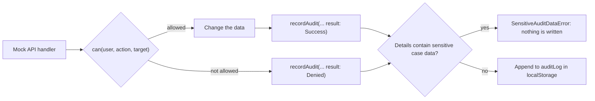

# F-005 Audit log

**Status:** In progress
**Spec:** [SPEC.md](../../SPEC.md#f-005-audit-log-approved-2026-10-17)

## What it does
Records who did what, when, and whether it was allowed, for the actions SPEC.md lists. Leaders read the log for
one case in their department; Admin reads the whole log with filters.

## Who can use it
| Role | Can |
|---|---|
| CaseWorker | – (their actions are logged) |
| Leader | View the audit log for a case in own department *(planned, T3.7)* |
| Admin | View the global audit log, filtered by case id, action, user, result and date *(planned, T3.8)* |

## How entries are written

- `recordAudit(db, input)` in `src/mocks/auditLog.ts` returns the database with the new entry; the handler saves it
  together with its own change, so the change and its audit entry are written at once.
- Each entry: `id`, `timestamp`, `userId`, `action`, `caseId?`, `result` (`Success` | `Denied`), `details`.
- `details` are flat key-value pairs. They refer to parties and users by id.
- **Sensitive data guard:** when the entry is about a case, `recordAudit` refuses details that equal or contain
  any sensitive value from that case (health personnel number and name, authorization text and dates,
  organization number, company name, description and address, reactions). Ids are allowed, and so is the audit
  log's own vocabulary (change codes, statuses, fields), so a name that happens to appear inside a code (a surname
  "Field" in `FieldChanged`) does not block an entry. Reactions are not part of that vocabulary.
- The log is saved in `localStorage` with the rest of the mock data (oldest first) and emptied by **Reset mock data**.

## Built so far
| Part | Task | Status |
|---|---|---|
| Writing entries in the mock API | T1.4 | Done |
| "Case created" | T2.1 | Done |
| "Case opened" (details: `view` full or restricted) | T2.2 | Done |
| "Case assigned" (previous and new case worker id) and "status changed" (from, to) | T2.3 | Done |
| "Case updated" (`details.change`: FieldChanged, HealthPersonnelAdded, HealthPersonnelRemoved) | T2.4 | Done |
| "Case updated" for companies (`CompanyAdded`, `CompanyRemoved`, by company id) | T2.5 | Done |
| "Reaction given" (`HealthPersonnelReactionGiven` / `CompanyReactionGiven`, by party id, never the reaction) | T2.6 | Done |
| "Status changed" for closing and reopening (from, to) | T2.7 | Done |
| "Read access granted" / "read access removed" (by case worker id) | T3.3 | Done |
| "User added" (`addedUserId`) | T3.4 | Done |
| "User updated" | T3.5, T3.6 | *(planned, with each action)* |
| Audit log per case (Leader) | T3.7 | *(planned)* |
| Global audit log with filters (Admin) | T3.8 | *(planned)* |

## Data
`AuditEntry`, `AuditAction`, `AuditResult`, `AuditDetails` (`features/audit-log/types.ts`), `recordAudit` (`mocks/auditLog.ts`).
