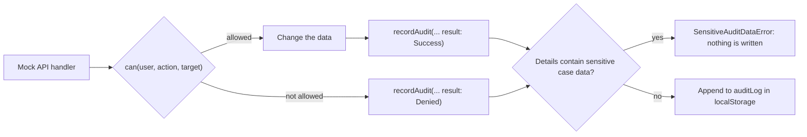
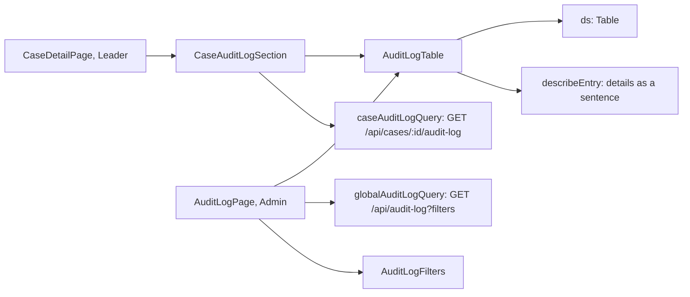

# F-005 Audit log

**Status:** Done
**Spec:** [SPEC.md](../../SPEC.md#f-005-audit-log-approved-2026-10-17)

## What it does
Records who did what, when, and whether it was allowed, for the actions SPEC.md lists. Leaders read the log for
one case in their department; Admin reads the whole log with filters.

## Who can use it
| Role | Can |
|---|---|
| CaseWorker | – (their actions are logged) |
| Leader | View the audit log for a case in own department, on the case page |
| Admin | View the global audit log (**Audit log** in the menu), filtered by case, action, user, result and date |

## How entries are written

- `recordAudit(db, input)` in `src/mocks/auditLog.ts` returns the database with the new entry; the handler saves it
  together with its own change, so the change and its audit entry are written at once.
- Each entry: `id`, `timestamp`, `userId`, `action`, `caseId?`, `result` (`Success` | `Denied`), `details`.
- `details` are flat key-value pairs. They refer to parties and users by id.
- **Sensitive data guard:** when the entry is about a case, `recordAudit` refuses details that equal or contain
  any sensitive value from that case (health personnel number and name, authorization text and dates,
  organization number, company name, description and address, reactions). Ids are allowed, and so is the audit
  log's own vocabulary (change codes, statuses, fields), so a name that happens to appear inside a code (a surname
  "Field" in `FieldChanged`) does not block an entry. Reactions are not part of that vocabulary.
- The log is saved in `localStorage` with the rest of the mock data (oldest first) and emptied by **Reset mock data**.

## Reading the log

- **Per case (T3.7):** a leader of the case's department (`can(user, 'viewCaseAuditLog', case)`) sees an **Audit log**
  section at the bottom of the case page, newest first: time, user, action, result and details. Changes made on the
  page refresh it. Opening the page is itself an entry ("case opened").
- **Global (T3.8):** Admin (`can(user, 'viewGlobalAuditLog')`) sees every entry, with the case number, on the
  **Audit log** page. Filters: case (case number or case id, applied on Enter or when leaving the field), action,
  user, result, and from/to dates (whole days, in the user's time zone). They combine, are kept in the page address,
  and can be cleared.
- Both endpoints answer 403 for anyone else, and reading the log is not itself logged. Each response has the entries
  plus the names of the users and the numbers of the cases they refer to, so the screens need no other lookups.
- **Details as a sentence** (`describeEntry`): user ids become names, department ids department names, codes labels
  ("Unassigned → Assigned", "To Maja Dahl, borrowed from the Department of Business Management"). User updates are
  worded as what was asked for ("Deactivate Magnus Berg"), so they read right for Denied entries too.
- **Health personnel and companies** are named only in the leader's log, from the case they already see in full; a
  party no longer in the case shows as "(removed from the case)". Admin's log never names them (sensitive case data).
- On narrow screens the table scrolls sideways in its own region, which can then be focused so keyboard users can
  scroll it (`useScrollableRegion`).

## Built so far
| Part | Task | Status |
|---|---|---|
| Writing entries in the mock API | T1.4 | Done |
| "Case created" | T2.1 | Done |
| "Case opened" (details: `view` full or restricted) | T2.2 | Done |
| "Case assigned" (previous and new case worker id) and "status changed" (from, to) | T2.3 | Done |
| "Case assigned": a borrowed case worker's home department (`homeDepartmentId`) | T3.10 | Done |
| "Case updated" (`details.change`: FieldChanged, HealthPersonnelAdded, HealthPersonnelRemoved) | T2.4 | Done |
| "Case updated" for companies (`CompanyAdded`, `CompanyRemoved`, by company id) | T2.5 | Done |
| "Reaction given" (`HealthPersonnelReactionGiven` / `CompanyReactionGiven`, by party id, never the reaction) | T2.6 | Done |
| "Status changed" for closing and reopening (from, to) | T2.7 | Done |
| "Read access granted" / "read access removed" (by case worker id) | T3.3 | Done |
| "User added" (`addedUserId`) | T3.4 | Done |
| "User updated" for deactivating (`updatedUserId`, `isActive: false`) | T3.5 | Done |
| "User updated" for reactivating (`updatedUserId`, `isActive: true`) | T3.9 | Done |
| "User updated" for fields and department (`change`, new fields or from/to department) | T3.6 | Done |
| Audit log per case (Leader) | T3.7 | Done |
| Global audit log with filters (Admin) | T3.8 | Done |

## Data
`AuditEntry`, `AuditAction`, `AuditResult`, `AuditDetails`, `AuditLogResponse` (`features/audit-log/types.ts`),
`AuditLogFilters` (`features/audit-log/filters.ts`), `recordAudit` (`mocks/auditLog.ts`), the read endpoints in
`mocks/handlers/auditLogViews.ts`.
