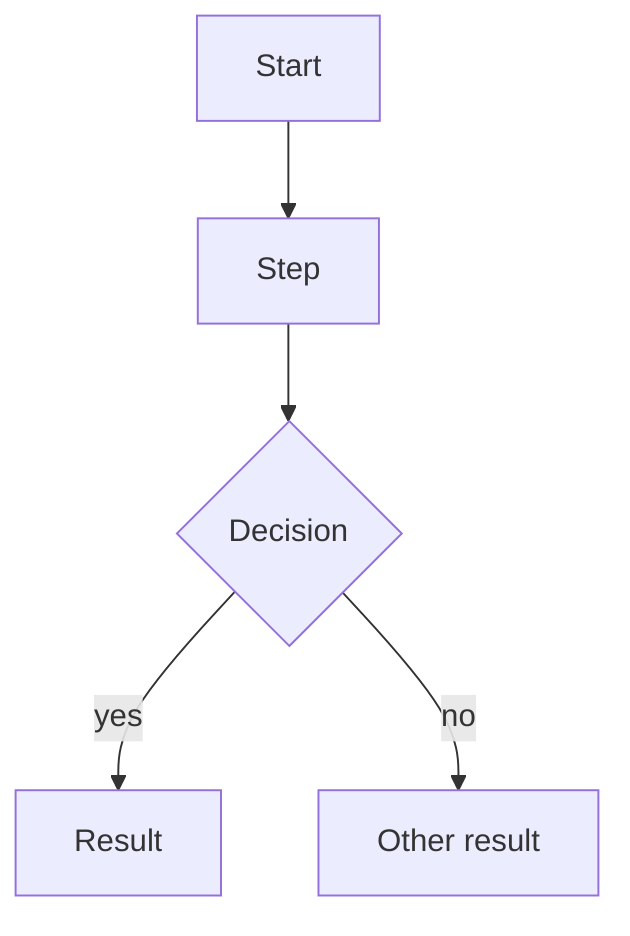
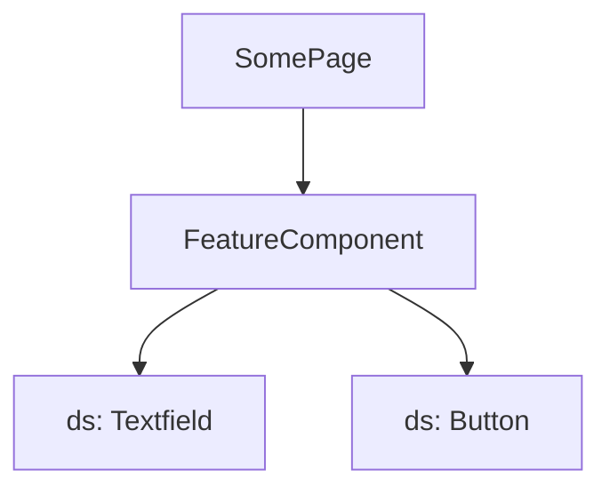

# F-xxx <Feature name>

**Status:** Draft | Approved | In progress | Done (same as SPEC.md)
**Spec:** [SPEC.md](../../SPEC.md#f-xxx)

## What it does
One or two sentences from the user's point of view.

## Who can use it
| Role | Can |
|---|---|
| CaseWorker | |
| Leader | |
| Admin | |

## User flow

## Screens and components

## Data
Which types, hooks and mock API endpoints it uses.
