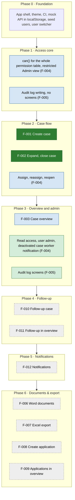
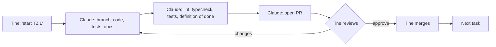

# Roadmap

One page that shows every feature, which build phase it belongs to, and its status.
Sources: [SPEC.md](../SPEC.md) (status), [BUILD_PLAN.md](../BUILD_PLAN.md) (phases and tasks), [PROJECT_PLAN.md](../PROJECT_PLAN.md) (scope).

## Phases
Green = Approved, blue = In progress, dark green = Done, grey dashed = Draft (criteria refined before its phase starts).
F-004 and F-005 are built in parts across Phases 1–3.

| Feature | Status | Criteria | Phases | Project plan scope |
|---|---|---|---|---|
| F-001 Create case | Done | Written | 2 | v1 |
| F-002 Expand case | Done | Written | 2 | v1 |
| F-003 Case overview | In progress | Written | 3 | v1 |
| F-004 Access control | In progress | Written | 1, 2, 3 | v1 |
| F-005 Audit log | In progress | Written | 1, 3 | v1 |
| F-010 Follow-up case | Draft | Partly written | 4 | v1 |
| F-011 Follow-up in overview | Draft | Missing | 4 | v1 |
| F-012 Notifications | Draft | Partly written | 5 | v1 |
| F-006 Word documents | Draft | Missing | 6 | Later |
| F-007 Excel export | Draft | Needs list of non-sensitive fields | 6 | Later |
| F-008 Create application | Draft | Missing | 6 | Later |
| F-009 Applications in overview | Draft | Missing | 6 | Later |

## How a task moves

## Decisions (2026-10-17)
- F-010, F-011 and F-012 stay in v1. Their criteria are refined as we go and approved before their phase starts.
- F-008 and F-009 stay in Phase 6 and are defined later.
- Milestones are dropped; only the build phases are used.
